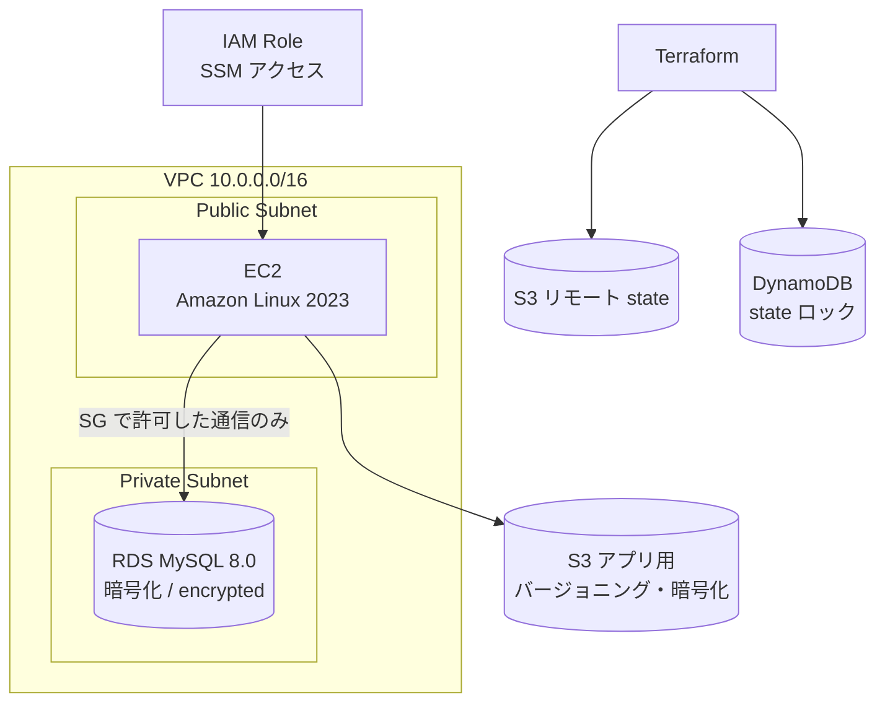
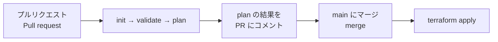

# Terraform Multi-Environment AWS Infrastructure | Terraform による複数環境の AWS インフラ

開発環境（dev）と本番環境（prod）の AWS インフラを Terraform で管理し、GitHub Actions で plan と apply を自動化したプロジェクトです。

AWS infrastructure for separate dev and prod environments, managed with Terraform and automated with GitHub Actions.


---

## 構成図 / Architecture



---

## 作成するリソース / Resources

| リソース / Resource | 内容 / Details |
|---|---|
| VPC | パブリックとプライベートのサブネット / public and private subnets |
| EC2 | Amazon Linux 2023、暗号化した gp3 ボリューム |
| RDS | MySQL 8.0、プライベートサブネット、暗号化 |
| S3（アプリ用） | バージョニング、AES256 暗号化 |
| S3（state 用） | Terraform のリモート state |
| DynamoDB | state のロック（同時実行による破損を防止） |
| IAM | SSM で接続できる EC2 用ロール（SSH 鍵を使わない運用） |
| Security Group | RDS へは EC2 のセキュリティグループからのみ接続可能 |

---

## 環境ごとの違い / Dev vs Prod

| 項目 / Setting | Dev | Prod |
|---|---|---|
| EC2 | t3.micro | t3.medium |
| RDS | db.t3.micro | db.t3.small |
| アベイラビリティゾーン / AZs | 2 | 3 |
| RDS Multi-AZ | なし / No | あり / Yes |
| 削除保護 / Deletion protection | なし / No | あり / Yes |
| 削除時のスナップショット / Final snapshot | なし / No | あり / Yes |

dev は費用を抑え、prod は可用性とデータ保護を優先しています。

Dev keeps costs low. Prod prioritises availability and protecting data.

---

## CI/CD パイプライン / Pipeline



| ワークフロー / Workflow | タイミング / Trigger | 内容 / Steps |
|---|---|---|
| `terraform-plan.yml` | main へのプルリクエスト | init、validate、plan。結果を PR にコメント |
| `terraform-apply.yml` | main へのマージ | init、apply |

レビューする人は、マージ前に「何が作られ、何が変わるか」を PR 上で確認できます。

Reviewers can see exactly what will change before anything is merged.

---

## 使い方 / Getting started

**必要なもの / Prerequisites:** Terraform 1.5.0 以上、AWS CLI、AWS アカウント（dev は無料枠でほぼ動きます）

```bash
git clone https://github.com/amishanita/terraform-multi.git
cd terraform-multi
terraform init
terraform plan
terraform apply
```

GitHub Actions で使う Secrets（Settings → Secrets → Actions）：

| Secret | 内容 |
|---|---|
| `AWS_ACCESS_KEY_ID` | IAM ユーザーのアクセスキー |
| `AWS_SECRET_ACCESS_KEY` | IAM ユーザーのシークレットキー |

> ⚠️ 確認が終わったら `terraform destroy` で削除してください。RDS は止めておくだけでも費用がかかります。
> Run `terraform destroy` when you are done. RDS costs money even when idle.

---

## 改善点 / Next steps

- 現在はマージで自動 apply しています。本番は手動承認を入れる形に変えたいと考えています。 / Add a manual approval step before applying to prod.
- アクセスキーを GitHub Actions の OIDC に置き換え、長期の認証情報をなくす予定です。 / Replace access keys with OIDC.
- `main.tf` 1ファイルにまとまっているので、VPC・EC2・RDS をモジュールに分けたいです。 / Split `main.tf` into modules.
- `tflint` や `checkov` で、コードの品質とセキュリティのチェックを CI に追加したいです。 / Add tflint and checkov to CI.

---

**Tamang Amish**　|　[GitHub](https://github.com/amishanita)　|　[LinkedIn](https://www.linkedin.com/in/tamang-amish-669289250)
